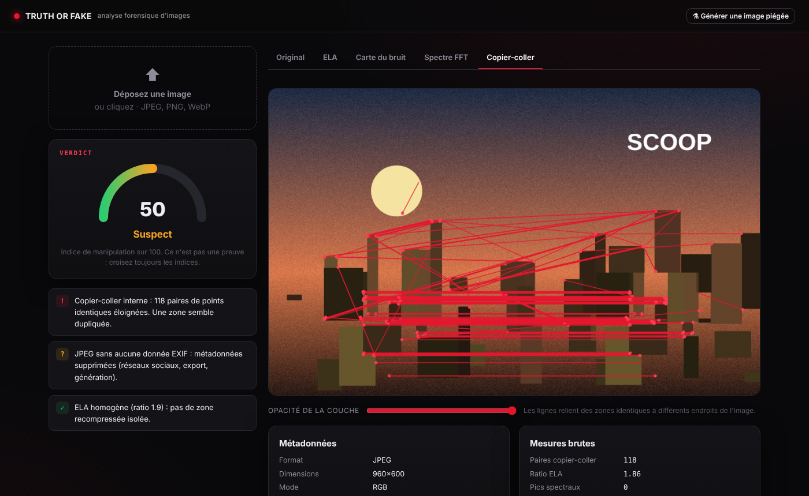

# ◐ Truth or Fake

> Examine une image pour repérer des indices de retouche ou de génération par IA, analyse des métadonnées comprise.



## Ce que l'outil vérifie
| Analyse | Ce qu'elle révèle |
|---|---|
| **Métadonnées EXIF / blocs PNG** | appareil, logiciel de retouche, dates incohérentes, prompts Stable Diffusion / ComfyUI, signatures Midjourney, DALL·E, Firefly…, manifeste **C2PA** |
| **ELA** (Error Level Analysis) | zones qui se recompressent différemment du reste, typique d'un collage |
| **Carte du bruit** | résidu haute fréquence par bloc : un bruit trop uniforme (IA, lissage) ou des régions incohérentes |
| **Spectre FFT** | pics périodiques laissés par le suréchantillonnage des GAN et des modèles de diffusion |
| **Copier-coller interne** | points ORB identiques à des endroits éloignés : zone clonée |
| **Qualité JPEG** | estimée à partir des tables de quantification |

Chaque indice a un poids. Le score final (0–100) en est la somme bornée et s'accompagne d'explications en français.
L'interface affiche chaque couche par-dessus l'original avec une opacité réglable.

Le bouton **« Générer une image piégée »** crée dans le navigateur une image truquée (zone dupliquée et texte ajouté) pour tester l'outil immédiatement.

## Lancer
```bash
pip install -r requirements.txt
python app.py      # → http://127.0.0.1:5002
python -m pytest -q
```

## Limites
Aucun détecteur n'est infaillible : une image authentique fortement compressée peut paraître suspecte, et une image générée peut être nettoyée de ses métadonnées. L'outil sert à **orienter** une vérification, pas à trancher seul.

## Pistes
- Classifieur entraîné (CNN) sur un jeu « réel / généré » en complément des heuristiques
- Vérification cryptographique complète des manifestes C2PA
- Recherche d'image inversée pour retrouver la source originale

## Licence
MIT © Jimo0x
